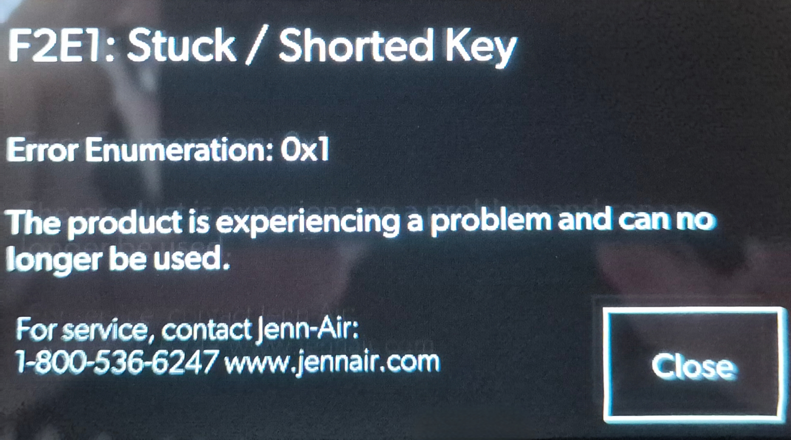
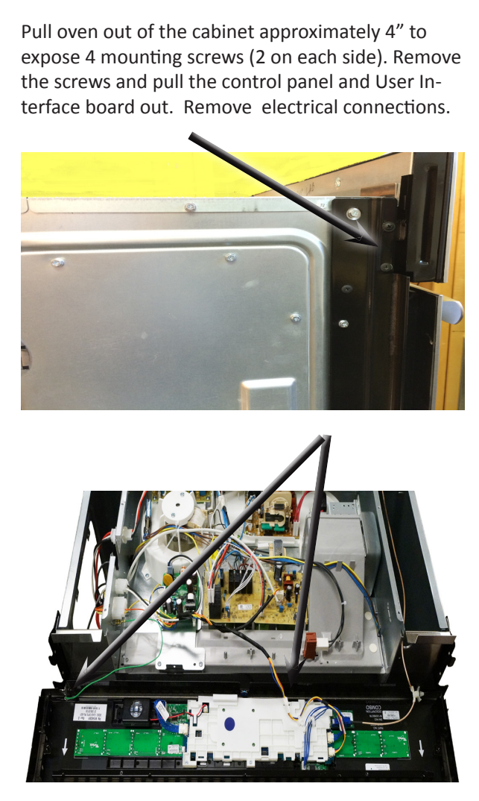
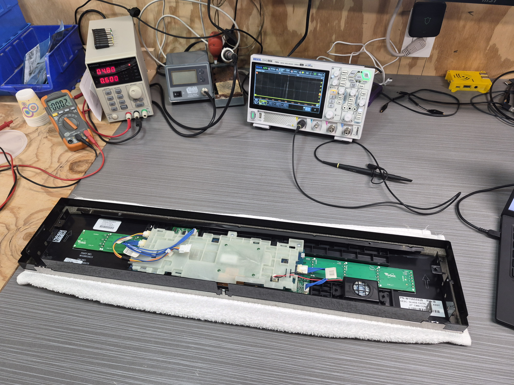
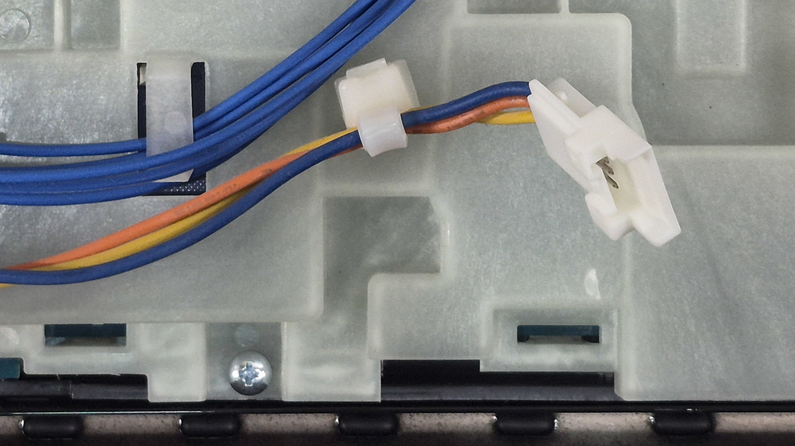
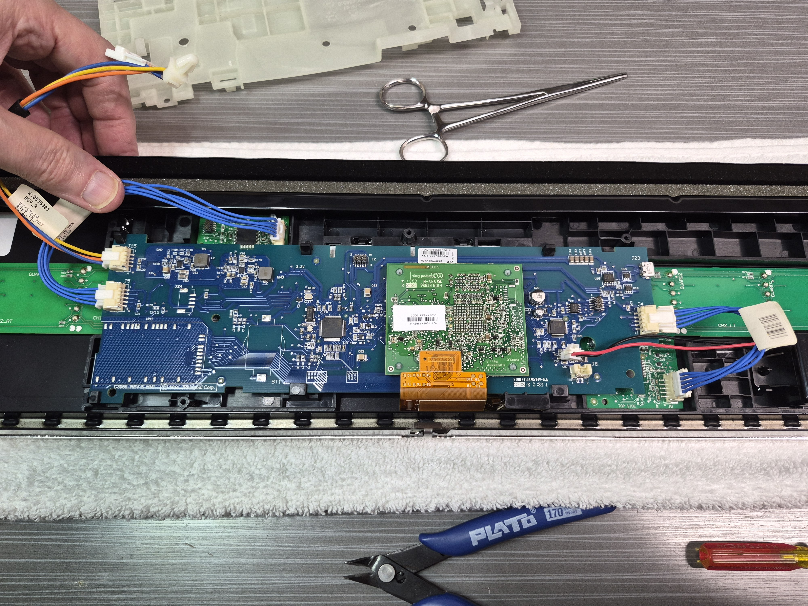
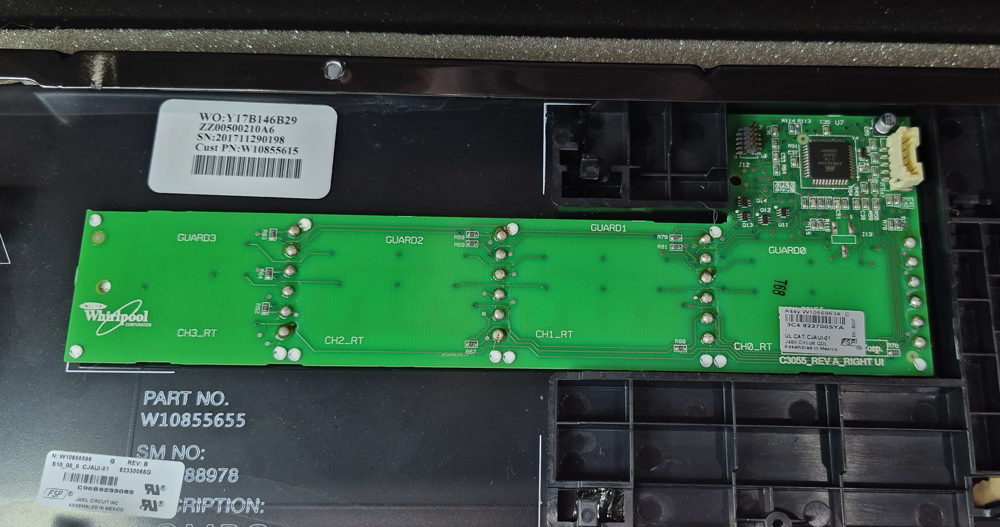
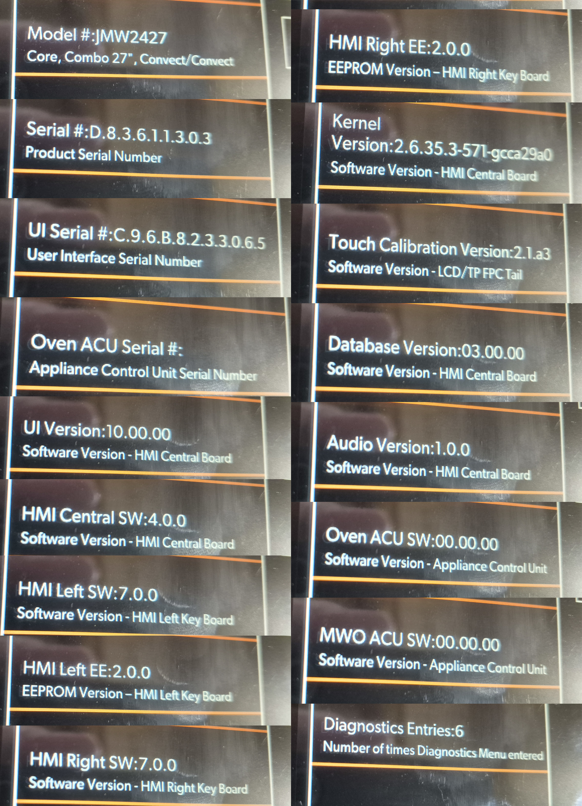
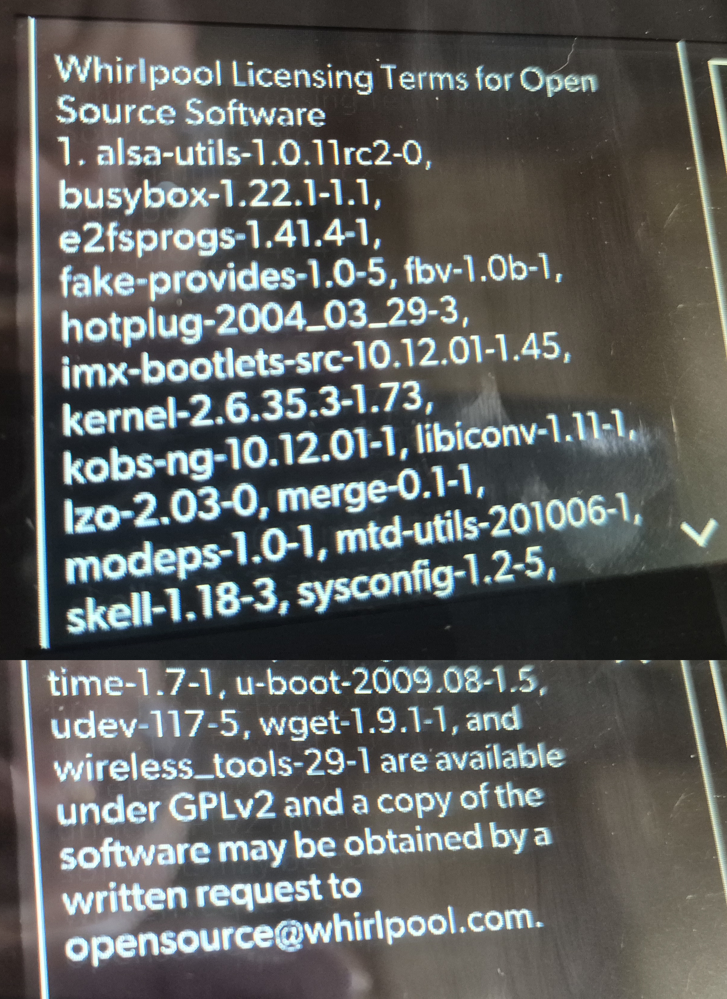

# The Tale of an Overly Complicated Pizza Heater: An Engineer's Descent into Appliance Madness

It all began on an otherwise unremarkable morning when our decade-old Jenn-Air combination wall oven (model JMW2427DS02, proudly churned out by the Whirlpool Corporation) decided that its primary mission in life was no longer reheating leftovers, but delivering existential dread.

Without warning, the high-end front glass lit up with a cryptic, passive-aggressive greeting:

Really? Oh, I am so sorry the product is not having a good experience. I would love to meet the product manager who came up with this message.

"Can no longer be used." Not "please check your keypad," not "cleaning recommended." Just a polite digital brick wall. Naturally, dismissing the prompt by tapping the "Close" button would let everything work, for about four glorious seconds, before the error gleefully resurfaced to lock down the kitchen once again.

Unfortunately, consumer-grade rituals like cleaning the glass or cycling power did not help the product have a better experience. A quick survey of the appliance parts landscape revealed the punchline: Whirlpool's authorized remedy was a brand-new front control panel assembly.

Price tag? Somewhere north of **$900**.

Now, I'll be damned if I am going to shell out a grand to a conglomerate because a capacitive touch trace got grumpy. I'm an electronics engineer. I design circuits, wrangle microcontrollers, reverse-engineer digital signals and sniff out protocols on an oscilloscope.

I am not about to buy a new panel. We were taking this thing to the dissecting table.

---

### Act I: The Teardown

Thankfully, extracting the console assembly didn't require dragging the entire 200-pound beast out of its cabinet cavity. A cautious four-inch slide forward, a few side trim screws and the console hinged forward quite easily.

Over to the workbench it went, nestled safely onto a bath towel right in front of my trusty power supply and my beloved oscilloscope.

The first pleasant surprise came upon inspecting the harness: the interface between the chassis and the front panel wasn't an impenetrable mess of 50 discrete wires. It was a single latching connector with just three wires populated: blue, orange, and yellow.

Standard Whirlpool folklore usually insists on a 5V logic feed, but a quick continuity check against the PCB ground planes revealed a classic high-end appliance twist:

* **Yellow wire:** Dead short ($0\ \Omega$) to the labeled `GND` test point.
* **Blue wire:** $0\ \Omega$ directly to an internal test point labeled **`14V`**!

To avoid massive $I^2R$ voltage drops running high-current backlights and speaker audio across the chassis harness, Whirlpool runs a raw 14V DC bus up to the panel and has it buck down to 5V and 3.3V locally.

I dialed my bench supply to 12V DC, clamped the current limit to a safe 350 mA, and flipped the switch. The panel booted up drawing a max of around 180 mA and hit me with the dreaded **`F2E1 Enumeration: 0x1`**.

The fault was self-contained in the panel console. The circuitry in the belly of the oven was absolved.

---

### Act II: Architecture and the "Disconnected" Trap

Stripping away the inner protective plastic shield exposed the sprawling central motherboard flanked by two satellite touch "wings": a Left Wing (microwave keys) and a Right Wing (conventional oven keys). Right in the middle sat a mezzanine board driving the color TFT. 

Moving outward, discrete blue wire harnesses linked the center board to each wing board. One the right wing board, the silkscreen showed the location of the button pads as: 

* `CH0_RT`, `CH1_RT`, `CH2_RT`, `CH3_RT`
* `GUARD0`, `GUARD1`, `GUARD2`, `GUARD3`

The left board had the same with `_LT` suffixes.

Since our error enumeration was `0x1` (maybe bitmask for channel 0 or 1?), isolating the bad actor seemed trivial: unplug a wing and see what happens.

I killed power, yanked the jumper feeding the **Left Wing (`_LT`)**, and fired the supply back up.

The screen blinked. The `F2E1` disappeared, only to be replaced by:

> **F2E0: Keypad Disconnected (Enumeration 0x9 / 0x8)**

Wait a minute. The power-on self-test routines might check presence and link continuity before they bother running sensor calibration. If the firmware detects an open circuit on the Left wing, it might abort the boot sequence and scream "Disconnected!" long before it ever scans the Right wing for a stuck key.

To prove it, I performed the inverse test: left wing reconnected, **Right Wing (`_RT`) unplugged**.

Sure enough, on boot-up, the screen flashed **`F2E1 Stuck Key`** for a split second before the watchdog/link-check caught up and stamped `F2E0 Disconnected` over it.

Got it! The fault appeared to be with the **Right Wing (`_RT`)**.

---

### Act III: The QMatrix Mystery

Peeling the center board away gave an unobstructed view of the entire right wing board, and that's when the true design revealed itself.

These weren't simple passive capacitive copper tabs running back to the main board. Sitting right on the satellite PCB was a mighty **Atmel ATmega324A** 8-bit microcontroller ([datasheet](https://ww1.microchip.com/downloads/en/DeviceDoc/ATmega164A_PA-324A_PA-644A_PA-1284_P_Data-Sheet-40002070B.pdf)) surrounded by four DDC123JU dual pre-biased transistor SOT-363 packages driving backlighting LEDs ([datasheet](https://www.diodes.com/assets/Datasheets/DDC_XXXX_U.pdf)) and a smattering of passives.

Each satellite wing was an active, intelligent sensor node running Atmel's proprietary **QTouch/QMatrix** capacitive sensing library, transmitting processed keypresses back to the host via serial packets! So that's one ATmega324A for the four buttons on the right and *another* ATmega324A for the other four buttons on the left.

Looking closely at the touch regions, they weren't single pads. They were **three vertical pairs of through-hole contact pads** mating to conductive springs behind the front glass.

* Pads 1, 3, and 5 each routed through a $100\ \Omega$ series resistor tied to a common burst drive rail.
* The lower paired pads formed the complementary receive matrix lines diving into inner-layer traces back to the ATmega's analog pins.

I grabbed the multimeter to hunt for high-impedance leakage. If kitchen grease or steam had infiltrated the glass sandwich, I'd see a measurable shunt between the sensor traces and the guard planes.

I probed across adjacent receive pads and found a fairly consistent approximately $31\text{ M}\Omega$** across every single channel.

No carbon shorts. No conductive moisture bridges. The resistors were dead-on spec. Electrically and statically, this board was pristine.

So why was the firmware convinced key `0x1` was permanently shorted out?

---

### Act IV: The Ghost in the Machine

Puzzled, I hooked my scope probe to the ATmega324A's ground and sense lines, ready to capture the dynamic charge-transfer pulse trains on power-up. I reached over and flicked on the 12V bench supply power.

The screen lit up. But instead of the familiar `F2E1` insult, the display produced a message I had never seen before:

> **Power failure - The system has recovered from a loss of power**
> `[ Close ]`

I tapped "Close."

The dialog vanished. The home screen appeared.

I tapped the capacitive keys on the right wing. Everything worked. No silly messages. No bling bling error sound. The touch panel was functioning flawlessly.

I sat there staring in disbelief. I hadn't replaced a component. I hadn't reflowed a solder joint. Did mechanical relaxation shift the capacitance? Did our probing trigger an obscure hardware reset? 

No! As we will learn soon, we had stumbled right into a state machine bug in Whirlpool's firmware!

---

### Act V: Welcome to Linux 2.6 on an Oven

Hunting for answers, I dug into the service literature and unearthed Whirlpool's secret 63-page service manual for the JMW2427/2430 family (*Job Aid W10813197*). I found it on the manualslib site at this (link)[https://www.manualslib.com/manual/1586820/Jenn-Air-Jmw2430d.html]. Be careful, this is one of those "malvertising" sites where all the ad links look like download buttons. 

The manual was enlightening for two reasons:

1. It gave the actual secret handshake to enter Diagnostics mode on this revision:

$$\text{LOWER OVEN} \longrightarrow \text{LOWER LIGHT} \longrightarrow \text{LOWER CANCEL}\quad\text{(Repeated 3 times!)} \text{}$$

2. It proved that Whirlpool treats the entire control console as a non-serviceable "black box." The troubleshooting flow chart for `F2E1 Stuck Key` literally says: *Check connections; if good, replace Control Panel Assembly*. Not a single mention of the ATmega controllers, QTouch baselines, or internal test points.

I stepped over to the bench panel, tapped the 9-key sequence, and slipped past the velvet rope into the internal Diagnostics menu. Scrolling down to **System Information**, the screen revealed a terrifying cascade of firmware modules:

There it was:

* **HMI Central SW: 4.0.0**
* **HMI Left SW: 7.0.0 / EE: 2.0.0**
* **HMI Right SW: 7.0.0 / EE: 2.0.0**
* **Kernel Version: 2.6.35.3-571-g0ca29a0**

*Kernel version?!*

I tapped into the Open Source Software Licensing menu. Of course! It's running a Linux kernel and userland stack from the 2010s.

Listed in glowing white text on black glass was an entire Linux operating system stack: **U-Boot 2009.08**, **Linux Kernel 2.6.35**, **BusyBox 1.22.1**, **ALSA audio utilities**, **e2fsprogs**, **mtd-utils**, and **kobs-ng** (NXP/Freescale's NAND bootstream tool)!

The Apollo Guidance Computer landed twelve human beings on the lunar surface using about 145,000 lines of code. This kitchen appliance was running tens of millions of lines of C code for an embedded ARM9 processor with a full POSIX multitasking operating system and embedded SQL database.

All to bake cookies!

---

### Act VI: The Smoking Gun and the Breaker Trick

With the panel proven operational on the bench, we performed standard preventive maintenance: scrubbed the satellite PCBs with 99% anhydrous IPA, brushed a protective layer of conformal coating over the matrix passives to lock out future steam, and reinforced the lower chassis foam gasket.

Confident that the mechanical gremlins were banished, I hauled the console back to the kitchen, plugged in the 14V/WIDE harness, bolted the chassis tight into the cabinetry, and flipped the 240V breaker.

The screen booted up.

And right on cue, with mocking precision:

> **F2E1: Stuck / Shorted Key**
> **Error Enumeration: 0x1**
> **The product is experiencing a problem and can no longer be used.**

My heart sank.

Was the board still broken? Was it mechanical pressure from the mounting screws?

And then I remembered, on the bench, the panel had only started working *after* throwing that unusual **"Power failure - The system has recovered from a loss of power"** dialog. I also remembered during our bench tests, that dialog *only ever appeared if power was cut while the display was in the "on" state*.

Here's my theory. When the panel is "off" or standby state, Linux is idle. If you cycle the circuit breaker while the oven is asleep, the Linux host performs a normal "clean cold boot."

During a clean cold boot:

1. The firmware pulls a **cached calibration baseline** out of EEPROM..
2. It compares the current physical capacitance of the ten-year-old glass sandwich against that decade-old factory baseline.
3. Because the adhesive and glass have experienced slight, natural dielectric aging over ten years of heat cycles, the raw baseline delta ($\Delta C$) exceeds Whirlpool's overly strict startup tolerance.
4. It immediately flags the channel as held down and screams `F2E1: Stuck Key`.

**The Reproducible Workaround:**

What happens if the power dies while the panel is wide awake?

I woke the screen up so the menus were actively glowing, and walked over to the circuit breaker panel. *Clack.* I tripped off the 240V double-pole breaker while the oven panel was in "on" state. I waited a few seconds and popped the breaker back on.

The oven initiated its boot sequence. But this time, because power had vanished mid-stride, the Linux supervisor detected an **unclean shutdown state**. Instead of trusting the cached non-volatile calibration registers in EEPROM, the firmware branched into its power-fail recovery routine: it presented the "Power failure" notification and instructed the Atmel ATmega324A to **dynamically measure and establish a brand-new in-situ capacitive baseline**!

The ATmega read the glass's current physical capacitance, said *"Looks like zero to me,"* and locked it in.

I tapped "Close" to the power failure message.

The error vanished. Every button lit up and responded with crisp, immediate feedback. The oven preheated to 350°F without a whimper. And it has stayed that way, running reliably ever since.

---

### Epilogue: The Scoreboard

* **Whirlpool's Authorized "Fix":** Replace a perfectly healthy control panel assembly for $900+.
* **The Engineer's Fix:** $0.00, 10 ml of isopropyl alcohol, a splash of conformal coating and flipping a circuit breaker while the screen is awake.

We live in an era where appliances are engineered as distributed computing nodes with operating systems sophisticated enough to run a rocket ship, yet deployed with edge-case firmware bugs that trick consumers into scrapping whole machines over picofarad-level calibration checks.

Consider this round won by the right-to-repair crowd. Now, if you'll excuse me, I have a pizza to bake.
